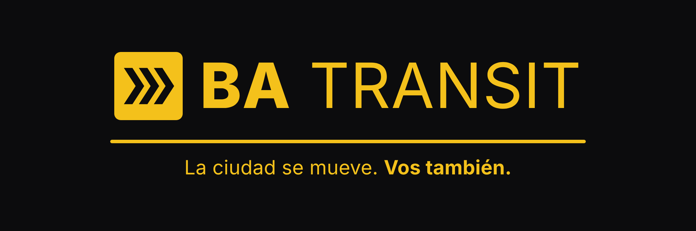
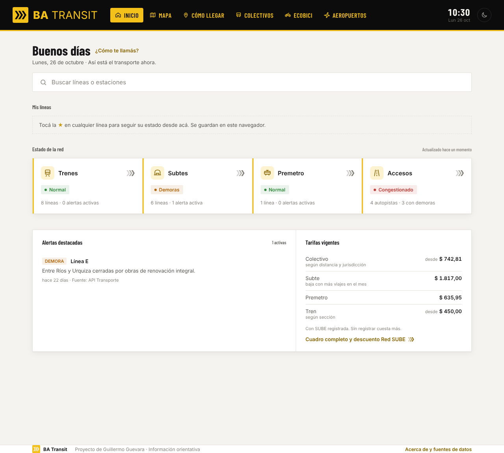
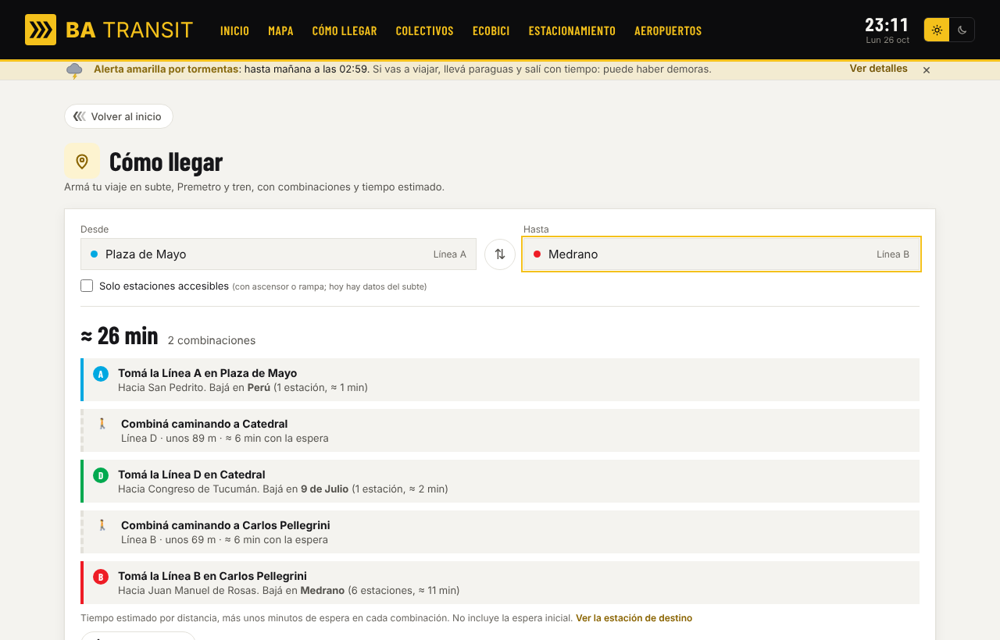
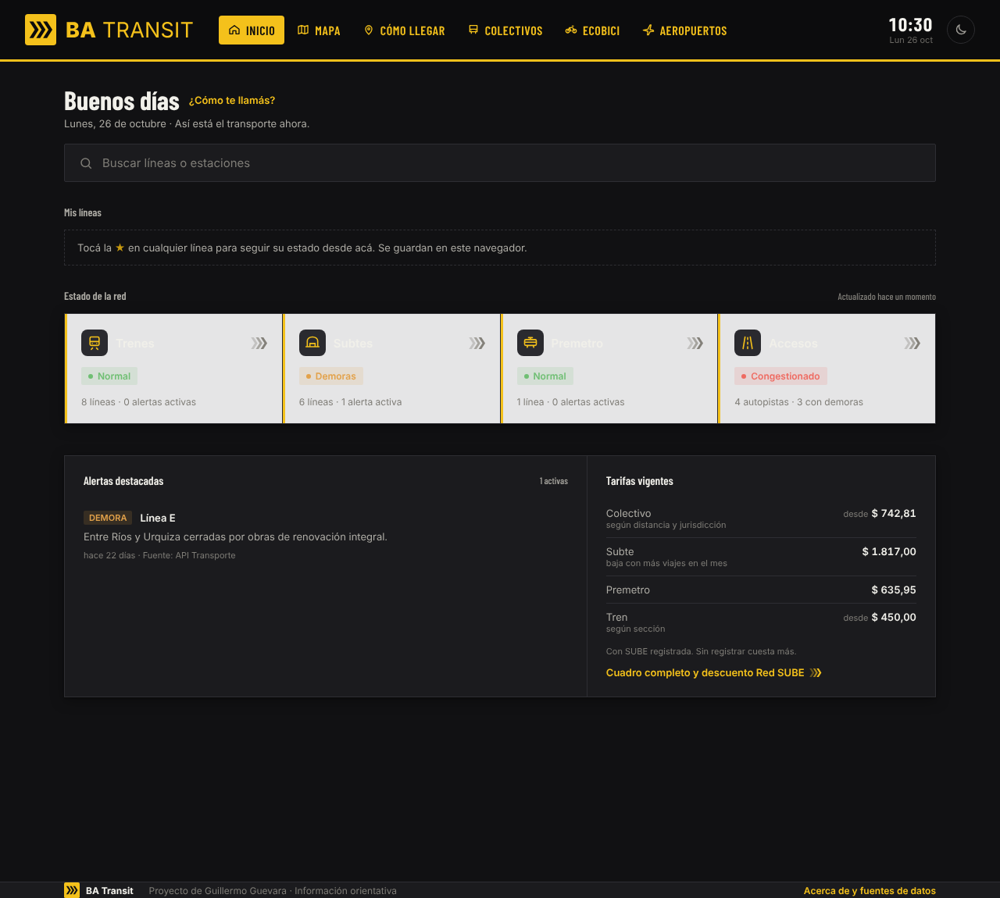
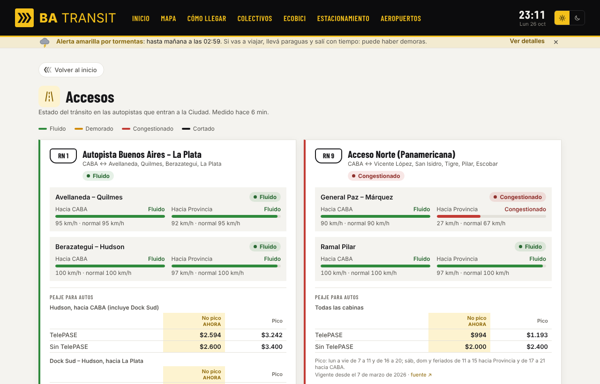
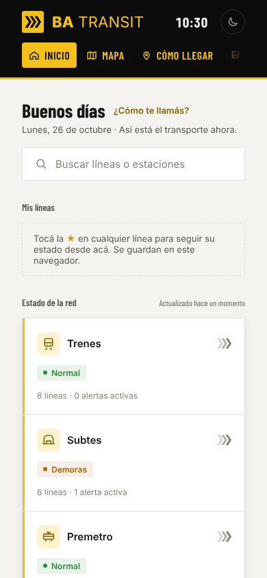
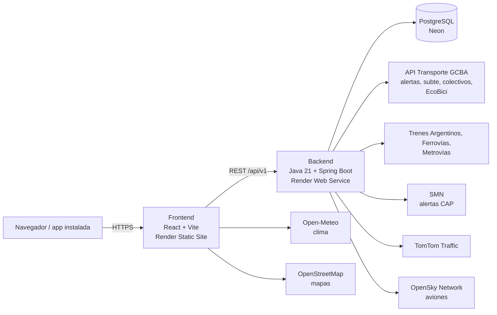

<p align="center">
  
</p>

<p align="center">
  <a href="https://ba-transit.onrender.com"><strong>Ver el sitio en vivo →</strong></a>
</p>

<p align="center">
  
  
  
  
  
  
</p>

# BA Transit

**El estado del transporte de Buenos Aires en un solo lugar.** Subte, Premetro, trenes, colectivos, accesos a la
Ciudad, EcoBici, estacionamiento y aeropuertos: alertas en vivo, próximos trenes, recorridos, tarifas, tránsito en
las autopistas y un planificador de viajes.

La información del transporte del AMBA está repartida entre muchas fuentes oficiales, cada una con su formato. BA
Transit las reúne, las cruza y las muestra de forma simple, pensada para consultar rápido antes de salir.

Es mi primer proyecto personal de portfolio, hecho de punta a punta: backend, frontend, base de datos, integración
con APIs públicas, pruebas, integración continua y despliegue.

<p align="center">
  
</p>

<p align="center">
  
  
</p>

<p align="center">
  
  
</p>

> Las capturas usan datos de muestra.

## Funcionalidades

**Estado de la red**
- Estado de cada modo (trenes, subtes, Premetro, accesos) y alertas de servicio sincronizadas cada 5 minutos desde la
  API Transporte de la Ciudad.
- Alertas meteorológicas del Servicio Meteorológico Nacional (tormentas, lluvias, calor) que afectan al AMBA, con un
  consejo para quien va a viajar.
- Eventos masivos, manifestaciones y obras que cortan calles, con aviso en las estaciones y los accesos cercanos.
- **Estado de los datos**: una página muestra cuándo respondió cada fuente por última vez y si alguna está fallando,
  con un indicador en el pie de todas las páginas.

**Subte, Premetro y trenes**
- Mapa interactivo de toda la red con recorridos reales, combinaciones y filtro de estaciones accesibles.
- Página de cada línea y de cada estación: próximos trenes, último tren de la noche, historia, lugares cercanos,
  colectivos que paran cerca y accesibilidad.
- Próximos trenes: en vivo para el subte (API Transporte) y el Belgrano Norte (pantallas de Ferrovías); según el
  horario programado para el subte sin datos en vivo y para el Urquiza (horario de Metrovías, con servicio nocturno).
- Estado del Urquiza leído del panel de Metrovías, y avisos de obras y servicios limitados de Trenes Argentinos.
- **Cómo llegar**: planificador propio (algoritmo de Dijkstra sobre el grafo de la red) con combinaciones, tiempo
  estimado, opción de viajar solo por estaciones accesibles y enlace para compartir el viaje.

**Colectivos, accesos y más**
- Colectivos en movimiento en tiempo real sobre el mapa, búsqueda por número, recorrido con paradas y tiempos, y
  avisos de cada línea.
- Tránsito en las autopistas de acceso (TomTom Traffic), medido en cada mano (hacia CABA y hacia Provincia), y cuadro
  de peajes que resalta la tarifa vigente según la hora pico.
- Estacionamiento: 2.700 garajes y las playas de la Ciudad, lugares para motos, 1.600 playas del conurbano
  (OpenStreetMap) por partido, y búsqueda de los más cercanos.
- Estaciones de EcoBici con bicis y anclajes disponibles.
- Aviones en vivo alrededor de Aeroparque y Ezeiza (OpenSky Network): cuáles están aterrizando, despegando o en
  tierra, con altura y velocidad.
- Aeropuertos con el clima actual y cómo llegar.
- Cuadro tarifario completo del AMBA y simulador del descuento Red SUBE.

**Experiencia**
- Modo claro y oscuro (sigue al sistema la primera vez), diseño adaptado a celular y feriados marcados en la fecha.
- Accesibilidad: 100 en Lighthouse (contraste, nombres accesibles en el mapa, navegación con teclado).
- Direcciones legibles para compartir: `/lineas/subte-b`, `/estaciones/subte-b/medrano`, `/red/trenes`,
  `/colectivos?linea=53A`.
- Instalable como app en el celular, con pantalla "Sin conexión".
- Cada página se descarga recién cuando se abre, para que la primera visita sea liviana.

## Arquitectura



- **Backend**: API REST con Spring Boot. Sincroniza las fuentes externas con tareas programadas y guarda en caché las
  respuestas en vivo, para que muchas visitas juntas no se conviertan en muchas llamadas a las APIs. Las credenciales
  nunca se escriben en los logs.
- **Base de datos**: PostgreSQL con el esquema versionado en 42 migraciones de Flyway: líneas, ramales, estaciones con
  coordenadas reales, alertas, tarifas, servicios especiales y eventos.
- **Frontend**: React con React Router y Leaflet. La lógica (planificador, tarifas, horarios, textos) vive en funciones
  puras con sus propias pruebas, separada de los componentes.

## Decisiones técnicas destacadas

- **Datos en vivo con tolerancia a fallas**: si una API externa no responde, se muestran los últimos datos válidos y
  se avisa, en lugar de romper la página.
- **Planificador propio**: grafo construido a partir de las estaciones (tramos, cambios de ramal y combinaciones a pie)
  y camino más rápido con Dijkstra. Las estaciones con el mismo nombre y cercanas (Retiro, Once) se agrupan para salir
  por la línea que más conviene.
- **Lectura de alertas CAP**: el SMN publica sus alertas en el estándar de la Organización Meteorológica Mundial. El
  backend las lee, descarta las canceladas o reemplazadas y se queda con las que cubren el AMBA, comprobando si el
  polígono de la alerta contiene puntos de la Ciudad y el conurbano.
- **Fuentes sin API pública**: el estado del Urquiza se lee de la conexión en tiempo real (SignalR) del panel de
  Metrovías; los próximos trenes del Belgrano Norte, del HTML de las pantallas de Ferrovías; el horario del Urquiza,
  del PDF oficial, validado al cargarlo (así apareció y se corrigió un error de tipeo del original).
- **Cuidar los cupos gratuitos**: TomTom da 20.000 consultas por mes. Cada medición se reutiliza 20 minutos y hay un
  tope diario; si dos tramos caen en el mismo tramo de TomTom, se muestran como uno en lugar de repetir el dato.
  Los aviones se piden a OpenSky solo cuando alguien mira la sección, y el dato se reutiliza 30 segundos (con cuenta)
  o 5 minutos (sin cuenta), dentro del cupo diario de cada caso.
- **Salud de las fuentes**: cada integración informa si respondió o falló; una falla aislada no marca la fuente como
  caída. Los servicios de la Ciudad que hoy no funcionan se prueban una vez por semana.
- **Seguridad**: los endpoints de escritura piden una clave de administrador (`X-API-Key`), los errores siguen el
  formato estándar Problem Details (RFC 9457) y el XML externo se procesa sin entidades externas.
- **Calidad**: pruebas unitarias, de controllers y de repositorios en el backend, de la lógica del frontend y de punta
  a punta en un navegador real (Playwright), todas en GitHub Actions en cada push.

## Tecnologías

| Capa | Herramientas |
|---|---|
| Backend | Java 21, Spring Boot 3.5, Spring Data JPA, Flyway, springdoc-openapi (Swagger UI) |
| Base de datos | PostgreSQL 16 (Neon en producción, Docker en desarrollo) |
| Frontend | React 18, Vite, React Router, Leaflet / React Leaflet |
| Pruebas | JUnit 5, Mockito, MockMvc, Vitest, Playwright, ESLint |
| Infraestructura | Docker Compose, GitHub Actions, Render, UptimeRobot |

## Fuentes de datos

| Dato | Fuente |
|---|---|
| Alertas de subte y colectivos, próximos trenes del subte, colectivos y EcoBici | [API Transporte del Gobierno de la Ciudad](https://www.buenosaires.gob.ar/desarrollourbano/transporte/apitransporte) |
| Avisos de los trenes | [Trenes Argentinos](https://www.argentina.gob.ar/transporte/trenes-argentinos/modificaciones-en-el-servicio-y-novedades) |
| Próximos trenes del Belgrano Norte | [Ferrovías](http://proximostrenes.ferrovias.com.ar/) |
| Estado y horarios del Urquiza | [Metrovías](https://metrovias.com.ar/) |
| Estacionamiento | [Buenos Aires Data](https://data.buenosaires.gob.ar/) y [OpenStreetMap](https://www.openstreetmap.org/copyright) (conurbano) |
| Alertas meteorológicas | [Servicio Meteorológico Nacional](https://www.smn.gob.ar/alertas) |
| Tránsito en los accesos | [TomTom Traffic](https://www.tomtom.com/products/traffic-apis/) |
| Aviones en vivo | [OpenSky Network](https://opensky-network.org/) |
| Clima en los aeropuertos | [Open-Meteo](https://open-meteo.com/) |
| Tarifas | [Red SUBE](https://www.argentina.gob.ar/redsube/tarifas-de-transporte-publico-amba) |
| Horarios y accesibilidad del subte | [Emova](https://emova.com.ar/) |
| Mapas | [OpenStreetMap](https://www.openstreetmap.org/copyright) |

## Estructura del proyecto

```
ba-transit/
├── backend/                  API REST (Java 21 + Spring Boot)
│   └── src/main/
│       ├── java/com/batransit/api/
│       │   ├── controller/   endpoints de líneas, estaciones, alertas, tarifas
│       │   ├── service/      lógica de negocio
│       │   ├── domain/       entidades JPA
│       │   ├── live/         datos en tiempo real (subte, colectivos, EcoBici)
│       │   ├── colectivos/   feed GTFS de colectivos
│       │   ├── accesos/      tránsito en autopistas (TomTom)
│       │   ├── clima/        alertas del SMN (CAP)
│       │   ├── vuelos/       aviones en vivo (OpenSky)
│       │   ├── eventos/      eventos masivos y cortes (carga manual)
│       │   ├── trenes/       avisos, Ferrovías y Metrovías
│       │   ├── estado/       salud de cada fuente de datos
│       │   └── security/     clave para los endpoints de escritura
│       └── resources/db/migration/   migraciones Flyway
├── frontend/                 cliente web (React + Vite)
│   ├── public/               íconos, manifest y service worker
│   └── src/
│       ├── pages/            una página por sección
│       ├── components/       componentes reutilizables
│       ├── hooks/            consumo de la API, favoritos, reloj
│       ├── utils/            lógica pura con pruebas
│       └── data/             datos fijos (historia, peajes, estacionamiento, horario del Urquiza)
│   └── e2e/                  pruebas de punta a punta (Playwright)
├── docs/capturas/            imágenes de este README
└── .github/workflows/        integración continua
```

## Cómo correrlo

Requisitos: Docker, Java 21, Maven y Node 22.

```bash
git clone https://github.com/guilleguevara245/ba-transit.git
cd ba-transit
```

**Backend**

```bash
cd backend
cp .env.example .env      # completar las variables (ver abajo)
docker compose --env-file .env up --build
```

La API queda en `http://localhost:8080` y la documentación interactiva en `http://localhost:8080/swagger-ui.html`.

| Variable | Para qué | Si falta |
|---|---|---|
| `TRANSPORTE_CLIENT_ID` / `TRANSPORTE_CLIENT_SECRET` | API Transporte ([registro gratuito](https://www.buenosaires.gob.ar/form/formulario-de-registro-api-transporte)) | sin alertas, subte en vivo ni colectivos |
| `TOMTOM_API_KEY` | estado del tránsito en los accesos | Accesos sin estado en vivo |
| `OPENSKY_CLIENT_ID`, `OPENSKY_CLIENT_SECRET` | aviones en vivo cada 30 s | se consulta sin cuenta, cada 5 min |
| `ADMIN_API_KEY` | endpoints de escritura (`POST`) | escritura deshabilitada |

Más detalle en [`backend/README.md`](./backend/README.md).

**Frontend**

```bash
cd frontend
npm install
npm run dev
```

El sitio queda en `http://localhost:5173`. En desarrollo, Vite reenvía `/api` al backend local; en producción se
define `VITE_API_BASE_URL` (ver `frontend/.env.example`).

## Pruebas

```bash
# Backend (necesita PostgreSQL: docker compose up -d postgres)
cd backend && mvn clean verify

# Frontend
cd frontend && npm run lint && npm test

# De punta a punta (con el sitio compilado y servido)
cd frontend && npm run build && npx vite preview --port 4173 &
npm install --no-save playwright && npx playwright install chromium && node e2e/smoke.mjs
```

## Limitaciones conocidas

- Los trenes (salvo Belgrano Norte) no tienen datos en vivo: Trenes Argentinos no publica una API abierta.
- La API Transporte dio de baja los cortes y eventos, y hoy no responde con semáforos ni datos de movilidad: los
  eventos se cargan a mano y esos servicios se prueban una vez por semana por si vuelven.
- El estacionamiento del conurbano sale de OpenStreetMap (colaborativo): en algunos partidos hay pocos datos.
- Plan gratuito de Render: si nadie entró en un rato, la primera visita tarda en despertar el servidor.

## Autor

**Guillermo Guevara** · [GitHub](https://github.com/guilleguevara245)

## Licencia

MIT. Ver [`LICENSE`](./LICENSE).
